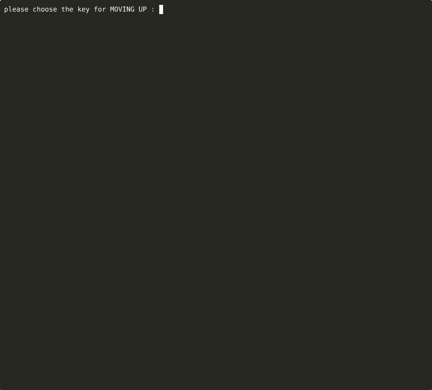

# Dungeon Crawler

A turn-based dungeon crawler for the terminal, in Java 17. Pick one of seven heroes across four classes, then fight through six levels of monsters, traps and bosses — with dice-rolled combat, levelling, and a special ability per class.

[](https://github.com/AsafCo2211/DungeonsAndDragons-OOP/actions/workflows/ci.yml)


Built for the *Object-Oriented Software Design* course at Ben-Gurion University.

<p align="center">
  
</p>

A real session: choose your keys, pick Arya Stark, walk into the soldier, and trade blows until it falls — each turn shows the battle log first, then the board it led to.

---

## How to play

```bash
mvn package
java -jar target/dungeon-crawler-1.0-uber-jar-with-sources-and-tests.jar levels
```

Or without Maven:

```bash
javac -d out $(find src/main/java -name '*.java')
java -cp out cli.Game levels
```

At the start you choose a key for each action (move ×4, skip turn, special ability, quit), then a hero.

| Symbol | Meaning |
|---|---|
| `@` | you |
| `.` / `#` | floor / wall |
| lowercase letters | monsters (e.g. `s` Lannister Soldier, `k` Lannister Knight) |
| uppercase letters | traps and bosses |

Walking into an enemy attacks it. Each attack rolls attack points against the defender's defence roll; the difference is damage. Kills grant experience; levelling up raises your stats and heals you. Clear every enemy to reach the next level.

| Class | Heroes | Special ability |
|---|---|---|
| Warrior | Jon Snow, The Hound | Avenger's Shield — hit a random enemy within 3 tiles for 10% of your max health, and heal; has a cooldown |
| Mage | Melisandre, Thoros of Myr | Blizzard — several hits on random enemies in range; costs mana |
| Rogue | Arya Stark, Bronn | Fan of Knives — hit every enemy within 2 tiles; costs energy |
| Hunter | Ygritte | ranged shot at the closest enemy in range; uses arrows |

The heroes and enemies follow the course assignment's specification.

## Design

```
units/      Unit → Player (Warrior, Mage, Rogue, Hunter) / Enemy (Monster, Trap, Boss)
tiles/      Tile → Empty, Wall — units are tiles too, so the board is one Tile[][]
abilities/  one class per special ability
game/       GameManager (board, turn order, round log), Board/Enemy controllers
values/     Health, Mana, Experience, Position — small value objects with their rules
cli/        Game loop, key mapping, level loading, menu formatting
```

- **Visitor for every interaction.** Moving onto a tile is `tile.accept(unit)`: an `Empty` swaps places, a `Wall` blocks, an `Enemy` starts a fight. The board never checks `instanceof` — each pair of types resolves through double dispatch (`TileVisitor`, `UnitVisitor`, `IPlayerVisitor`).
- **Pluggable dice.** Attack and defence rolls go through a `ValueGenerator`. The game uses `RandomGenerator`; tests use `DeterministicGenerator` with a fixed sequence, so combat outcomes are exact.
- **Callbacks instead of printing.** Game logic reports through `MessageCallback` / `DeathCallback` and a per-round message log, so it has no dependency on the console.
- **Factory for the roster.** `UnitFactory` maps each hero and each map letter to its unit.

## Bugs found while preparing this repo

Recording the demo exposed three bugs, all fixed:

1. **Piped input crashed the game.** Three separate `Scanner`s read `System.in`; the first buffered lines meant for the others. Typing hid it — input arrives a line at a time — but the game couldn't be scripted or tested end to end. There is now one reader, and the game exits cleanly when input ends.
2. **Every melee kill gave experience twice.** Both the game manager's death handler and the player's attack code awarded it, so heroes levelled up twice as fast as designed. A regression test pins it: one 25 XP kill now leaves the hero at 25/50, level 1.
3. **The battle log printed after the board** it produced, so the stats above already reflected damage the log hadn't shown yet. Each turn now reads in order.

## Tests

```bash
mvn test
```

17 JUnit 5 tests: health, mana and experience rules (including multi-level gains), level-up stat changes, monster chase behaviour, trap visibility cycles, and melee combat on a fixed board. GitHub Actions runs them on every push, builds the jar, and plays a scripted game through it.

## Limitations

- **`GameManager` is a global singleton.** Convenient for a course project, but it couples every class to it, and tests have to reset it with reflection between classes.
- **Two abilities bypass the dice abstraction.** Avenger's Shield and Blizzard pick their targets with `ThreadLocalRandom` directly, so those choices can't be fixed in tests the way combat rolls can.
- **Board rendering stops at an out-of-bounds exception** rather than reading the board's size.
